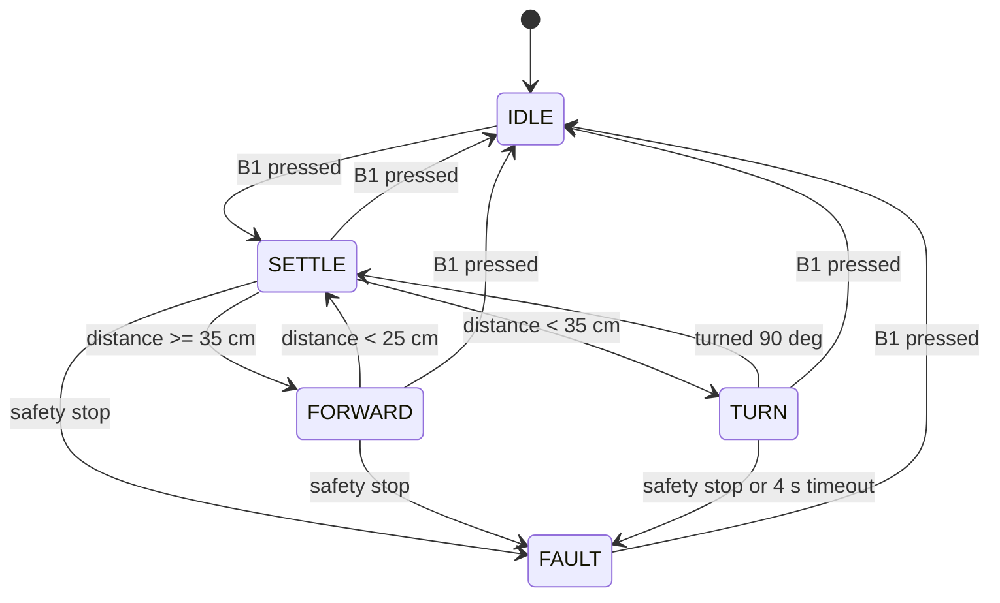

# Robo: Reactive Obstacle Avoidance Robot (STM32, bare-metal)

A two-wheeled robot that drives forward, stops in front of obstacles, turns 90 degrees using a gyroscope, and drives on. It runs on an STM32 Nucleo-F446RE and is written entirely at register level (CMSIS register names, no HAL peripheral drivers).

This is v1 of a larger project. It combines three subsystems that were first built and validated separately:

- [MotorControl](https://github.com/UmairHub/MotorControl): L298N motor driver with TIM3 PWM
- [mpu6050](https://github.com/UmairHub/mpu6050): MPU6050 IMU over I2C
- [ultrasonic_sensor](https://github.com/UmairHub/ultrasonic_sensor): HC-SR04 distance sensor

## Features

- **Obstacle avoidance:** stops below 25 cm, turns 90 degrees in place, re-checks, and continues.
- **Gyro-based turning:** heading is integrated from the MPU6050 Z gyro at 200 Hz with a measured time step.
- **Non-blocking distance measurement:** the HC-SR04 echo is timestamped in an interrupt, so it never stalls the control loop.
- **Safety stops:** collision, tip-over, IMU failure, missing echo, and turn timeout all stop the motors.
- **Robust I2C:** timeouts, NACK and bus error detection, automatic bus clear (9 SCL pulses + STOP) and peripheral reset.
- **Self-calibration:** gyro bias and accelerometer offsets at startup, then continuously tracked while parked.
- **Start / stop with the user button** (B1).
- **Live debug output** over the ST-Link USB serial port.

## Hardware

| Part | Notes |
|---|---|
| STM32 Nucleo-F446RE | Runs on the internal 16 MHz HSI clock |
| L298N dual H-bridge | Drives both motors |
| 2x DC motor + chassis | Differential drive (left / right) |
| MPU6050 (GY-521 module) | 3-axis accelerometer + gyroscope |
| HC-SR04 | Ultrasonic distance sensor, 5 V |
| 2 resistors (1 kOhm + 2 kOhm) | Voltage divider for the HC-SR04 ECHO line |
| Battery for the motors | 6x AA or 2S Li-ion recommended (a 9 V block sags under two motors) |

## Pin map

| Function | Pin | Nucleo header | Configuration |
|---|---|---|---|
| Motor A (left) ENA | PA6 | D12 / CN10-13 | TIM3_CH1, AF2, PWM |
| Motor A IN1 / IN2 | PA8 / PA9 | D7 / D8 | GPIO output, push-pull |
| Motor B (right) ENB | PA7 | D11 / CN10-15 | TIM3_CH2, AF2, PWM |
| Motor B IN3 / IN4 | PB4 / PB5 | D5 / D4 | GPIO output, push-pull |
| MPU6050 SCL | PB6 | D10 / CN10-17 | I2C1, AF4, open-drain |
| MPU6050 SDA | PB7 | CN7-21 (morpho only) | I2C1, AF4, open-drain |
| HC-SR04 TRIG | PB0 | A3 / CN7-34 | GPIO output |
| HC-SR04 ECHO | PB1 | CN10-24 (morpho only) | EXTI1, both edges, through divider |
| User button B1 | PC13 | on board | Input, active low |
| UART debug | PA2 / PA3 | via ST-Link USB | USART2, 115200 8N1 |

## Wiring

```
Nucleo PA6  ---- ENA  (remove the ENA jumper on the L298N)
Nucleo PA8  ---- IN1
Nucleo PA9  ---- IN2
Nucleo PA7  ---- ENB  (remove the ENB jumper on the L298N)
Nucleo PB4  ---- IN3
Nucleo PB5  ---- IN4
L298N OUT1/OUT2 ---- left motor
L298N OUT3/OUT4 ---- right motor
Battery +   ---- L298N +12V terminal
Battery -   ---- L298N GND ---- Nucleo GND   (common ground is required)

Nucleo 3V3  ---- GY-521 VCC
Nucleo GND  ---- GY-521 GND
Nucleo PB6  ---- GY-521 SCL
Nucleo PB7  ---- GY-521 SDA

Nucleo 5V   ---- HC-SR04 VCC
Nucleo GND  ---- HC-SR04 GND
Nucleo PB0  ---- HC-SR04 TRIG
HC-SR04 ECHO ---[1 kOhm]---+--- Nucleo PB1
                           |
                        [2 kOhm]
                           |
                          GND        (5 V x 2/3 = 3.3 V)
```

Notes:

- **Mount the MPU6050 flat, chip side up, and rigidly.** Z must point up: heading, tip detection, and collision detection depend on it. Startup calibration refuses to finish if the board is not flat.
- Use soldered or crimped connections for the IMU. Loose jumper wires on a moving robot cause I2C dropouts.
- Power the Nucleo from USB during bench tests. Never connect the motor battery to a Nucleo pin.
- If a wheel turns the wrong way, swap that motor's two wires on the L298N.

## How it works

### Scheduler

One cooperative loop runs all tasks from a 1 ms SysTick counter:

| Task | Period | Job |
|---|---|---|
| IMU | 5 ms (200 Hz) | 14-byte burst read, heading integration, collision and tip checks |
| Ultrasonic | 60 ms | 12 us TRIG pulse; the echo result arrives by interrupt |
| Control | 20 ms (50 Hz) | State machine, motor commands, button |
| Debug print | 100 ms (10 Hz) | One status line over UART |

### Timers

| Timer | Use | Setup |
|---|---|---|
| SysTick | 1 ms tick for scheduling and timeouts | LOAD = 15999 |
| TIM2 | Free-running 32-bit counter, 1 us per tick, for delays and echo timestamps | PSC = 15, ARR = 0xFFFFFFFF |
| TIM3 | Motor PWM on CH1 and CH2, about 178 Hz | PSC = 89, ARR = 999 |

### State machine



- **SETTLE** stops for 300 ms and decides only on a distance measured while standing still.
- **TURN** spins left in place (left wheel back, right wheel forward) until the heading has changed by 90 degrees.

### Safety stops

Checked in SETTLE, FORWARD and TURN. Any of them stops the motors and enters FAULT; B1 clears it.

| Fault | Condition |
|---|---|
| `collision` | Horizontal acceleration above 0.6 g for 2 samples, ignored for 300 ms after a motor command change |
| `tipped` | Z acceleration below 0.5 g for 100 ms |
| `imu no data` | 20 failed IMU reads in a row (100 ms) |
| `ultrasonic` | No echo for 1 s |
| `turn timeout` | 90 degrees not reached within 4 s |

## Build and flash

1. Open the folder in STM32CubeIDE (File > Open Projects from File System).
2. Build (Ctrl+B) and flash with Run or Debug. The Nucleo's on-board ST-Link is used.
3. `SysTick_Handler` lives in `main.c`. The one in `Core/Src/stm32f4xx_it.c` is commented out. If code is regenerated from `Robo.ioc`, CubeMX restores it and the link fails with a duplicate symbol: comment it out again.

## Usage

Open the serial port (Linux example):

```bash
picocom -b 115200 /dev/ttyACM0
```

Boot sequence (offset values differ per chip):

```
Robot v1  build ...
SCL=1 SDA=1 BUSY=0
WHO_AM_I: 0x68
Calibrating IMU, keep still...
gz_off: -13.11  ax_off: 120  ay_off: -85
Ready. Press B1 to start / stop.
```

Keep the robot flat and still during calibration. If it moves or is not flat, calibration prints the reason and retries.

Status line (10 Hz):

```
st:FWD  d:123 cm  hdg:-12.34  axy:0.05 g  axy_max:0.40 g  imu_err:0
```

| Field | Meaning |
|---|---|
| `st` | State: IDLE, SETTLE, FWD, TURN, FAULT (with reason in brackets) |
| `d` | Distance in cm (400 = nothing in range) |
| `hdg` | Heading in degrees since boot, positive = counterclockwise seen from above |
| `axy` | Horizontal (X/Y) acceleration of the latest sample, in g |
| `axy_max` | Largest `axy` since the previous line, in g (catches short spikes) |
| `imu_err` | Failed IMU reads since boot |

If the IMU stops answering, the line shows `IMU DEAD SCL=x SDA=x` with the live bus levels instead of stale values.

## Tuning

All thresholds are `#define`s in the CONFIGURATION section of `Core/Src/main.c`:

| Define | Default | Purpose |
|---|---|---|
| `DUTY_FORWARD` / `DUTY_TURN` | 600 / 550 | Motor PWM duty (0 to 999) |
| `OBSTACLE_CM` / `CLEAR_CM` | 25 / 35 | Stop distance and drive-on distance (hysteresis) |
| `TURN_DEG` | 90 | Turn angle per avoidance |
| `COLLISION_G` | 0.6 | Collision threshold: set it between the highest `axy_max` while driving and the lowest from a real bump |
| `TIP_AZ_G` | 0.5 | Tip-over threshold |

## Bench test (wheels off the ground)

1. Clear path in front (`d` above 35 cm), press B1: SETTLE, then FWD, both wheels forward.
2. Hand closer than 25 cm: SETTLE, then TURN (left wheel back, right wheel forward). Rotate the robot by hand about 90 degrees: it returns to SETTLE.
3. Leave it in TURN without rotating it: `[turn timeout]` after 4 s. B1 clears it.
4. Watch `axy_max` while the motors run: this is the vibration level, and it must stay well below `COLLISION_G`.

## Known limitations

- Heading comes from gyro integration only and slowly drifts while driving. Bias is re-learned whenever the robot is parked in IDLE.
- No wheel encoders yet, so speed is open loop and the robot may veer when driving straight.
- The accelerometer offsets assume a flat floor. On ramps the tilt adds to `axy`.

## Roadmap

- Wheel encoders and closed-loop speed control
- v2: Raspberry Pi over UART for higher-level autonomy, CAN for distributed nodes, camera / LiDAR

## Repository layout

```
Core/Src/main.c          all application code (drivers, tasks, state machine)
Core/Src/stm32f4xx_it.c  CubeMX interrupt file (SysTick_Handler commented out)
Core/Startup/            startup assembly and vector table
Drivers/                 CMSIS headers and the CubeMX-generated HAL (not used by main.c)
Robo.ioc                 CubeMX project file
STM32F446RETX_FLASH.ld   linker script
```
